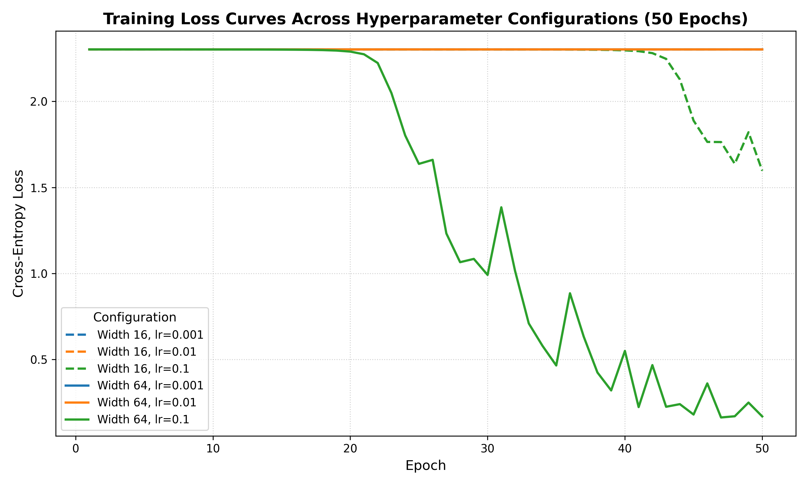

# Lab 2 — Multi-Layer Neural Network from Scratch

## 1. Goal

The goal of this lab is to implement a multi-layer perceptron (MLP) from scratch using only NumPy. The network is evaluated on the handwritten digits classification task (`sklearn.datasets.load_digits`). The assignment requires manual implementations of forward propagation, analytical backpropagation via the chain rule, numerical gradient checking via two-sided finite differences, mini-batch gradient descent, hyperparameter sensitivity analysis across six configurations, and execution profiling.

---

## 2. Dataset and Preprocessing

- **Dataset:** Optical Recognition of Handwritten Digits (`load_digits`), containing $1{,}797$ samples of $8 \times 8$ pixel grayscale images ($64$ features) distributed across 10 digit classes ($0$ through $9$).
- **Feature Normalization:** Pixel values lie in the range $[0, 16]$ and are scaled to $[0, 1]$ by dividing by $16.0$:
  $$X = \frac{X_{\text{raw}}}{16.0}$$
- **Label Encoding:** Labels $y \in \{0, \dots, 9\}$ are converted into one-hot encoded vectors of length $10$:
  $$Y \in \{0, 1\}^{m \times 10}$$
- **Data Splitting:** The data is partitioned into a training set ($70\%$, $1{,}257$ samples) and a test set ($30\%$, $540$ samples) using stratified sampling with `random_state=42`.

---

## 3. Network Architecture and Mathematical Formulation

### 3.1 Architecture Overview

- **Input layer:** $n^{[0]} = 64$ neurons
- **Hidden layer 1:** $n^{[1]} \in \{16, 64\}$ neurons with ReLU activation
- **Hidden layer 2:** $n^{[2]} \in \{16, 64\}$ neurons with ReLU activation
- **Output layer:** $n^{[3]} = 10$ neurons with Softmax activation
- **Weight initialization:** $W^{[l]} \sim \mathcal{N}(0, 0.01^2)$ for $l \in \{1, 2, 3\}$
- **Bias initialization:** $b^{[l]} = 0$ for $l \in \{1, 2, 3\}$

### 3.2 Forward Propagation Equations

For a mini-batch of $m$ input samples $X \in \mathbb{R}^{m \times 64}$:

1. **First Hidden Layer:**
   $$Z^{[1]} = X W^{[1]} + b^{[1]}, \quad A^{[1]} = \text{ReLU}(Z^{[1]}) = \max(0, Z^{[1]})$$

2. **Second Hidden Layer:**
   $$Z^{[2]} = A^{[1]} W^{[2]} + b^{[2]}, \quad A^{[2]} = \text{ReLU}(Z^{[2]}) = \max(0, Z^{[2]})$$

3. **Output Layer (Softmax):**
   $$Z^{[3]} = A^{[2]} W^{[3]} + b^{[3]}$$
   To ensure numerical stability against overflow, the row-wise maximum is subtracted before exponentiation:
   $$\tilde{Z}^{[3]} = Z^{[3]} - \max_{k}(Z^{[3]}_{i,k})$$
   $$A^{[3]} = \text{Softmax}(Z^{[3]}) = \frac{\exp(\tilde{Z}^{[3]})}{\sum_{k=1}^{10} \exp(\tilde{Z}^{[3]}_{i,k})}$$

### 3.3 Loss Function

The model optimizes the mean categorical cross-entropy loss over mini-batch size $m$:
$$\mathcal{L} = -\frac{1}{m} \sum_{i=1}^m \sum_{k=1}^{10} y_{i,k} \ln\left(\hat{y}_{i,k}\right) = -\frac{1}{m} \sum_{i=1}^m \sum_{k=1}^{10} y_{i,k} \ln\left(A^{[3]}_{i,k}\right)$$

### 3.4 Backpropagation Equations (Chain Rule)

Applying the chain rule analytically yields:

1. **Output Layer Error:**
   $$\frac{\partial \mathcal{L}}{\partial Z^{[3]}} = \frac{1}{m} \left(A^{[3]} - Y\right)$$
   $$\frac{\partial \mathcal{L}}{\partial W^{[3]}} = (A^{[2]})^T \frac{\partial \mathcal{L}}{\partial Z^{[3]}}, \quad \frac{\partial \mathcal{L}}{\partial b^{[3]}} = \sum_{i=1}^m \frac{\partial \mathcal{L}}{\partial Z^{[3]}_{i,:}}$$

2. **Second Hidden Layer Gradients:**
   $$\frac{\partial \mathcal{L}}{\partial A^{[2]}} = \frac{\partial \mathcal{L}}{\partial Z^{[3]}} (W^{[3]})^T$$
   $$\frac{\partial \mathcal{L}}{\partial Z^{[2]}} = \frac{\partial \mathcal{L}}{\partial A^{[2]}} \odot \mathbb{I}(Z^{[2]} > 0)$$
   $$\frac{\partial \mathcal{L}}{\partial W^{[2]}} = (A^{[1]})^T \frac{\partial \mathcal{L}}{\partial Z^{[2]}}, \quad \frac{\partial \mathcal{L}}{\partial b^{[2]}} = \sum_{i=1}^m \frac{\partial \mathcal{L}}{\partial Z^{[2]}_{i,:}}$$

3. **First Hidden Layer Gradients:**
   $$\frac{\partial \mathcal{L}}{\partial A^{[1]}} = \frac{\partial \mathcal{L}}{\partial Z^{[2]}} (W^{[2]})^T$$
   $$\frac{\partial \mathcal{L}}{\partial Z^{[1]}} = \frac{\partial \mathcal{L}}{\partial A^{[1]}} \odot \mathbb{I}(Z^{[1]} > 0)$$
   $$\frac{\partial \mathcal{L}}{\partial W^{[1]}} = X^T \frac{\partial \mathcal{L}}{\partial Z^{[1]}}, \quad \frac{\partial \mathcal{L}}{\partial b^{[1]}} = \sum_{i=1}^m \frac{\partial \mathcal{L}}{\partial Z^{[1]}_{i,:}}$$

4. **Parameter Updates (Mini-batch Gradient Descent):**
   $$W^{[l]} \leftarrow W^{[l]} - \eta \frac{\partial \mathcal{L}}{\partial W^{[l]}}, \quad b^{[l]} \leftarrow b^{[l]} - \eta \frac{\partial \mathcal{L}}{\partial b^{[l]}} \quad (\text{for } l = 1, 2, 3)$$

---

## 4. Gradient Checking

### 4.1 Methodology

Numerical gradients were approximated using central (two-sided) finite differences:
$$\frac{\partial \mathcal{L}}{\partial \theta_j} \approx \frac{\mathcal{L}(\theta_j + \epsilon) - \mathcal{L}(\theta_j - \epsilon)}{2\epsilon}$$
with perturbation parameter $\epsilon = 10^{-5}$. The relative error between the numerical gradient $g_{\text{num}}$ and analytical gradient $g_{\text{ana}}$ was computed as:
$$\text{Relative Error} = \frac{|g_{\text{num}} - g_{\text{ana}}|}{\max(10^{-8}, |g_{\text{num}}| + |g_{\text{ana}}|)}$$

### 4.2 Handling ReLU Non-Differentiable Points

The ReLU activation function has a non-differentiable kink at $Z = 0$. When a neuron pre-activation sits within $\pm \epsilon$ of zero, the perturbation flips the activation state ($\text{sign}(Z + \epsilon) \neq \text{sign}(Z - \epsilon)$), causing finite differences to span across a discontinuous derivative boundary. To guarantee mathematical validity, the gradient check verifies that no pre-activation changes activation mask between the positive and negative perturbation.

### 4.3 Results

| Parameter & Index |     Analytical Gradient      |      Numerical Gradient      |     Relative Error      |   Status   |
| :---------------- | :--------------------------: | :--------------------------: | :---------------------: | :--------: |
| $W_3(14, 0)$      | $-1.33858887 \times 10^{-5}$ | $-1.33858924 \times 10^{-5}$ | $1.3977 \times 10^{-7}$ | **Passed** |
| $W_2(4, 3)$       | $1.72172741 \times 10^{-4}$  | $1.72172743 \times 10^{-4}$  | $6.4171 \times 10^{-9}$ | **Passed** |
| $W_1(26, 11)$     | $-1.48362402 \times 10^{-4}$ | $-1.48362411 \times 10^{-4}$ | $3.0087 \times 10^{-8}$ | **Passed** |
| $W_3(11, 2)$      | $1.78749827 \times 10^{-5}$  | $1.78749682 \times 10^{-5}$  | $4.0627 \times 10^{-7}$ | **Passed** |
| $W_3(12, 2)$      | $2.01662367 \times 10^{-5}$  | $2.01662242 \times 10^{-5}$  | $3.0765 \times 10^{-7}$ | **Passed** |
| $W_1(10, 0)$      | $6.58384388 \times 10^{-5}$  | $6.58384458 \times 10^{-5}$  | $5.3028 \times 10^{-8}$ | **Passed** |
| $W_2(0, 9)$       | $1.05251771 \times 10^{-4}$  | $1.05251763 \times 10^{-4}$  | $3.7297 \times 10^{-8}$ | **Passed** |
| $W_1(46, 4)$      | $2.08051743 \times 10^{-5}$  | $2.08052020 \times 10^{-5}$  | $6.6568 \times 10^{-7}$ | **Passed** |
| $W_2(14, 9)$      | $2.08868320 \times 10^{-4}$  | $2.08868300 \times 10^{-4}$  | $4.7934 \times 10^{-8}$ | **Passed** |
| $W_3(8, 2)$       | $5.47033508 \times 10^{-5}$  | $5.47033530 \times 10^{-5}$  | $1.9914 \times 10^{-8}$ | **Passed** |

**Summary:** **10/10 checks passed** with relative error strictly below $10^{-6}$ (all errors between $6.4 \times 10^{-9}$ and $6.7 \times 10^{-7}$).

---

## 5. Experimental Results

All experiments were conducted over $50$ epochs with mini-batch size $32$, testing all combinations of hidden layer widths $\{16, 64\}$ and learning rates $\{0.001, 0.01, 0.1\}$.

### 5.1 Performance Summary Table

| Hidden Width | Learning Rate ($\eta$) | Final Training Loss | Test Accuracy |
| :----------: | :--------------------: | :-----------------: | :-----------: |
|      16      |         0.001          |       2.3025        |    10.19%     |
|      16      |          0.01          |       2.3025        |    10.19%     |
|      16      |          0.1           |       1.5970        |    32.59%     |
|      64      |         0.001          |       2.3025        |    10.19%     |
|      64      |          0.01          |       2.3023        |    10.19%     |
|    **64**    |        **0.1**         |     **0.1684**      |  **93.89%**   |

### 5.2 Loss Curves Analysis

1. **Low Learning Rates:**
   - The initial cross-entropy loss is approximately ln(10) = 2.302585, which is expected when the network predicts nearly uniform probabilities across ten classes.
   - With weights initialized from N(0, 0.01^2), the small initial activations and gradients slow down learning.
   - For learning rates 0.001 and 0.01, the loss remains close to 2.3025 after 50 epochs, and test accuracy remains at 10.19%.

2. **Effect of Learning Rate and Hidden Width:**
   - With hidden width 16 and learning rate 0.1, the loss decreases to 1.5970 and test accuracy reaches 32.59%.
   - With hidden width 64 and learning rate 0.1, the loss decreases to 0.1684 and test accuracy reaches 93.89%.
   - These results show that the learning rate has a strong effect on optimization under the required initialization. The wider network also performs better in this experiment.
   - The results describe these particular settings and 50-epoch training runs; they do not imply that smaller learning rates can never converge.

---

## 6. Execution Timing Benchmarks

| Operation                | Input Batch Size | Hidden Width |        Median Execution Time        |
| :----------------------- | :--------------: | :----------: | :---------------------------------: |
| **Forward Propagation**  |    32 samples    |      64      | **0.0443 ms** ($44.3\ \mu\text{s}$) |
| **Backward Propagation** |    32 samples    |      64      | **0.0476 ms** ($47.6\ \mu\text{s}$) |

Backward propagation takes slightly longer (~7.5% overhead) because it performs gradient calculations with respect to both weights and activations across each layer, in addition to activation derivative masking and bias summations.

---

## 7. Conclusions

1. **Analytical Backpropagation Correctness:** The analytical gradients matched the numerical finite-difference estimates in all 10 reported checks, with relative errors below 1e-6.

2. **Impact of Initialization:** The required small Gaussian weight initialization, N(0, 0.01^2), resulted in very small initial activations and slow learning for several configurations.

3. **Hyperparameter Sensitivity:** After 50 epochs, the configurations with learning rates 0.001 and 0.01 remained close to the initial loss of 2.3026. With learning rate 0.1, the network with hidden width 16 achieved 32.59% test accuracy, while the network with hidden width 64 achieved 93.89%.

4. **Execution Time:** Backward propagation took slightly longer than forward propagation in the measured configuration, consistent with the additional gradient calculations.

Overall, the lab demonstrates forward propagation, cross-entropy loss, analytical backpropagation, numerical gradient checking, mini-batch training, hyperparameter comparison, and execution timing using NumPy.
