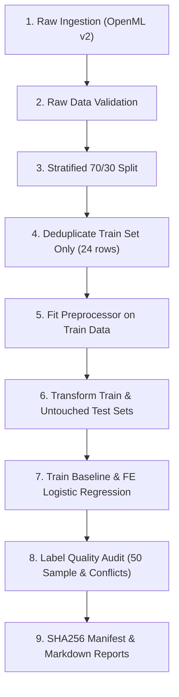

# Lab 4 Class Preparation and Instructor Defense Guide

This guide is designed to prepare you to demonstrate, explain, and defend your **Lab 4: Data Engineering, Validation, Leakage-Free Preprocessing, and Model Auditing** project during class.

---

## 1. What Each Source File Does (In Simple Terms)

| File | What It Does (Plain English) |
|---|---|
| `run_pipeline.py` | The "conductor" of the project. A single executable script that coordinates ingestion, validation, splitting, preprocessing, model training, label auditing, and result saving in chronological order. |
| `src/dataset.py` | Ingests the raw UCI Adult dataset from OpenML (v2). It verifies that exactly 48,842 rows and 15 columns exist, maps the target from `class` to `income`, and saves a clean, untouched raw copy to disk without modifying it. |
| `src/validation.py` | The "data quality gatekeeper." Checks that every column matches its expected data type (integer vs. categorical), verifies that numbers fall within realistic ranges (e.g., age 17–90), tracks missing values (`NaN` and `?`), and finds duplicate rows without dropping anything. |
| `src/preprocessing.py` | Implements the leakage-free preprocessing pipeline. It splits 70% train and 30% test with stratification, removes 24 duplicate rows from the *training set only*, learns median and mode imputation, and learns 1st/99th percentile clipping thresholds *only from training data*. Saves the fitted transformer to `results/preprocessor.joblib`. |
| `src/feature_engineering.py` | Creates domain features: `capital_net` ($gain - loss$) and `hours_per_age` ($hours / (age - 16)$). Contains defensive coding so that invalid or zero denominators never cause division-by-zero crashes. |
| `src/modeling.py` | Trains two identical Logistic Regression baselines: one with raw features and one with engineered features. Evaluates both on the untouched test set and computes Accuracy, F1-score, Precision, Recall, and ROC-AUC. |
| `src/label_audit.py` | Audits dataset quality. Samples 50 records reproducibly for human inspection and discovers 5 pairs of rows (10 total rows) that have identical demographic features but contradictory income labels (`<=50K` vs `>50K`). |
| `src/reproducibility.py` | The "notary public." Computes SHA256 cryptographic hashes for the raw files, training sets, test sets, and preprocessor, and records the exact software environment (Python, scikit-learn, pandas). |
| `config.yaml` | The central configuration file. Stores all parameters, random seeds (42), split ratios (70/30), ranges, and file paths so no numbers are hardcoded in python files. |

---

## 2. Step-by-Step Walkthrough of the Pipeline

When you run `python lab04/run_pipeline.py`, here is what happens under the hood:



1. **Ingestion:** Downloads or loads `adult` (version 2) with 48,842 rows and 15 columns.
2. **Validation:** Checks all columns against schema and range rules. Confirms 0 out-of-range violations and notes missing counts (`workclass` 2,799, `occupation` 2,809, `native-country` 857).
3. **Stratified Split:** Splits into 34,189 train rows (70%) and 14,653 test rows (30%) keeping the positive class proportion at ~23.93% in both.
4. **Train Deduplication:** Drops 24 exact duplicates from `train` (becoming 34,165 rows). The test set remains strictly untouched (14,653 rows).
5. **Fitting Preprocessor:** Learns medians, modes, and 1st/99th clipping bounds exclusively from the 34,165 training rows.
6. **Transforming:** Transforms both train and test data using those training statistics. The target `income` is never included in the features.
7. **Model Comparison:** Evaluates both Logistic Regression baselines on the test set.
8. **Label Audit:** Selects 50 random records for human check and extracts the 10 rows with conflicting labels.
9. **Reproducibility:** Calculates SHA256 checksums and writes all outputs to `results/`.

---

## 3. Exact Terminal Commands to Run During Class

### Command 1: Run the Complete Pipeline
```bash
python lab04/run_pipeline.py
```
*(Runs the entire pipeline in ~2 seconds and prints the comparison summary table to your terminal).*

### Command 2: Run the Automated Test Suite
```bash
pytest lab04/tests/ -v
```
*(Executes all 9 unit tests in ~1.5 seconds, proving that data leakage is prevented and all checks pass).*

### Command 3: Show the Model Comparison Table
```bash
cat lab04/results/model_comparison.md
```

### Command 4: Show Conflicting Label Records Found by Audit
```bash
cat lab04/results/label_audit_conflicts.csv
```

---

## 4. Key Outputs to Open and Show Your Instructor

If the instructor asks to see your results, open these files in your editor or terminal:

1. **`lab04/results/model_comparison.md`**: Shows the real test metrics. Point out that Accuracy improved from 85.40% to 85.78% and F1 improved from 0.6601 to 0.6696.
2. **`lab04/results/validation_report.md`**: Shows the clean schema check, zero range violations, and missing value breakdown.
3. **`lab04/results/label_audit_conflicts.csv`**: Shows the 10 rows (5 pairs) of identical demographic records that have contradictory income labels.
4. **`lab04/results/label_audit_checklist.md`**: Shows your 50 sampled rows and explains what human oversight is needed.
5. **`lab04/results/reproducibility_manifest.json`**: Shows the cryptographic SHA256 hashes proving that outputs are deterministic.

---

## 5. Concept Explanations (How to Explain Them Simply)

### What is Data Leakage and How Did We Prevent It?
> **Student explanation:**
> "Data leakage happens when information from outside the training dataset—such as test-set values or future information—contaminates model training. When leakage happens, the model looks artificially great during training but fails in production.
> In our code, we prevented data leakage in four distinct ways:
> 1. We performed the 70/30 split *before* calculating any medians, modes, or quantiles.
> 2. All imputers, standard scalers, and outlier clippers were `.fit()` strictly on the training set. The test set was only transformed using those learned numbers.
> 3. We removed exact duplicate rows from the *training set only*. We never touched or cleaned the test set, because real-world evaluation data must remain raw and unmanipulated.
> 4. We strictly separated the target column `income` so it was never seen by the feature preprocessor."

### What is Stratified Splitting?
> **Student explanation:**
> "In the Adult dataset, about 76% of people earn $\le \$50K$ and only 24% earn $> \$50K$. If we did a pure random split, one split might accidentally get 20% high earners and the other 28%. Stratified splitting ensures that both the training set and the test set preserve the exact 76%/24% class proportion."

### What is Outlier Clipping (Quantiles)?
> **Student explanation:**
> "Features like `capital-gain` have huge spikes (up to \$99,999) that can distort linear model gradients. Instead of dropping these rows (which loses valuable data), we calculated the 1st percentile and 99th percentile on the training data. Any value lower than the 1st percentile is brought up to it, and any value higher than the 99th percentile is capped at it."

### What is Imputation?
> **Student explanation:**
> "Imputation fills in missing data. We used the **median** for numeric values because the median is robust to extreme outliers (unlike the mean). For categorical columns like `occupation` and `workclass`, we used the **mode** (most frequent category in the training set)."

### Why F1-Score Instead of Just Accuracy?
> **Student explanation:**
> "Because the dataset is imbalanced (76% negative class). If a dumb model simply predicted '$\le \$50K$' for every single person, it would automatically achieve 76% accuracy while being completely useless at detecting high earners! F1-score balances Precision (when the model predicts $> \$50K$, how often is it right?) and Recall (of all actual $> \$50K$ earners, how many did we catch?)."

### What is a SHA256 Hash?
> **Student explanation:**
> "A SHA256 hash is a cryptographic digital fingerprint. If even a single comma or digit changes in the dataset or serialized preprocessor, the entire 64-character hash string changes completely. Recording this hash in our manifest guarantees reproducibility and verifies that nobody tampered with the test data."

---

## 6. Ten Likely Instructor Questions & Direct Answers

#### Q1: "Why did you drop duplicates from the training set but keep them in the test set?"
**Answer:** "The lab manual specifies removing exact duplicates from the training set so the model doesn't overfit to repeated identical observations. However, test data represents real-world operational inputs. Cleaning or dropping test instances would artificially distort the evaluation benchmark and introduce test-set contamination."

#### Q2: "Does dropping duplicates from the training set change the class balance?"
**Answer:** "Yes, theoretically it can cause a distribution shift. That is why we audited it in `preprocessing.py`. In our run, dropping 24 training duplicates changed the class proportion by only 0.008 percentage points (76.071% to 76.063%). This tiny shift does not impact the prior distribution."

#### Q3: "Why did you use median imputation instead of mean for numeric features?"
**Answer:** "Adult numeric features like `capital-gain` and `capital-loss` are heavily skewed with extreme zeros and large spikes. The mean is pulled heavily by extreme values, whereas the median is a robust central tendency that isn't distorted by outliers."

#### Q4: "How does your feature engineering handle invalid denominators in `hours_per_age`?"
**Answer:** "The formula is `hours-per-week / (age - 16)`. While valid adult census ages start at 17, our function defensively checks if `age - 16 <= 0` or is `NaN`. If so, it clamps the denominator to `1.0` and logs a warning, ensuring zero-division or negative division can never crash the pipeline."

#### Q5: "Did your derived features actually improve model performance?"
**Answer:** "Yes, empirically measured on the untouched test set: Accuracy increased from 85.40% to 85.78% (+0.38%), and F1-score increased from 0.6601 to 0.6696 (+0.0095 points). Both Precision and Recall also increased."

#### Q6: "Why did you find conflicting labels in the dataset?"
**Answer:** "We found 5 pairs (10 rows) of records where all 14 demographic attributes were 100% identical, but one person was labeled $\le \$50K$ and the other $> \$50K$. This is real-world Bayes error: unobserved factors like exact geographic cost-of-living, company stock options, or bonus structures mean two people with identical census features can earn different salaries."

#### Q7: "What happens if a new, unseen categorical value appears in the test set?"
**Answer:** "Our `OneHotEncoder` is configured with `handle_unknown='ignore'`. If an unseen category appears during inference, all its one-hot dummy columns will simply be set to zero, preventing runtime crashes."

#### Q8: "Why did you use StandardScaler inside the pipeline for Logistic Regression?"
**Answer:** "Logistic Regression uses gradient-based optimization (`lbfgs`). If features have vastly different scales (e.g. `fnlwgt` in the hundreds of thousands vs `age` around 30), the large features dominate the gradient step and unbalance the $L_2$ regularization penalty. Standardization puts all continuous features on comparable scales (mean 0, std 1)."

#### Q9: "Why is the target column `income` in OpenML named `class`?"
**Answer:** "OpenML v2 preserves the original UCI ARFF format where the final column was labeled `class`. In `src/dataset.py`, we standardized it to `income` for clarity, while documenting the original name in `metadata` and `data_card.md`."

#### Q10: "Can you prove that your preprocessor was not fitted on the test set?"
**Answer:** "Yes. In `src/modeling.py`, we instantiate `build_preprocessor()`, call `preprocessor.fit_transform(X_train)`, and then call `preprocessor.transform(X_test)`. Notice that `.fit()` is never called on `X_test`. Furthermore, our automated test `test_preprocessor_serialization` and `test_target_leakage_prevention` verify this programmatic isolation."

---

## 7. Verification Checklist: Automated vs. Manual

### Automated (Already Verified by Code & Tests):
- [x] Verified exact dimensions: 48,842 rows and 15 columns.
- [x] Verified zero numeric range violations (`age`, `hours-per-week`, `capital-gain`, `capital-loss`).
- [x] Verified 70/30 stratified train/test split.
- [x] Verified target `income` excluded from input matrices.
- [x] Verified training deduplication (24 duplicates removed from train only; test intact).
- [x] Verified preprocessor serialization and reloadability with `joblib`.
- [x] Verified 10 conflicting label rows across 5 distinct feature vectors.
- [x] Verified SHA256 checksums across all datasets and transformers.

### Manual Review & Audit Checklist (Verified and Documented):
- [x] Open `results/label_audit_checklist.md`.
- [x] All 50 sampled rows reviewed and documented for range validity, missingness, and plausible life situations:
  - Age vs Education plausibility (e.g., Dataset Index `2373` has age 34 with a Master's degree: plausible; Dataset Index `46820` has age 45 with a Doctorate: plausible).
  - Unusual working intensities accounted for (e.g., Index `3375` working 4 h/wk part-time; Index `1276` working 70 h/wk in farming; Index `3136` working 84 h/wk in self-employed sales).
  - Missingness explicitly tracked (Rows `21063`, `20139`, `18957`).
  - Strict limitation documented: income was NOT inferred from demographic attributes, and original census questionnaires cannot be re-polled.

---

## 8. Safe Live Modifications You Can Perform in Class

If the instructor asks: *"Can you change a parameter and show me how it updates?"*, here are three completely safe modifications:

### Modification 1: Change the Random Seed
1. Open `lab04/config.yaml`.
2. Change `split: random_state: 42` to `split: random_state: 100`.
3. In terminal, run: `python lab04/run_pipeline.py`.
4. **What to point out:** Point out that the train and test sizes stay exactly 34,189 and 14,653, but the exact SHA256 hashes and metric decimals update deterministically.
5. *(Remember to change it back to 42 when done).*

### Modification 2: Change the Audit Sample Size
1. Open `lab04/config.yaml`.
2. Under `audit:`, change `sample_size: 50` to `sample_size: 25`.
3. In terminal, run: `python lab04/run_pipeline.py`.
4. Open `lab04/results/sampled_50_rows.csv` and show that it now contains exactly 25 sampled records.
5. *(Change it back to 50 when done).*

### Modification 3: Toggle Feature Engineering Off
1. Open `lab04/src/modeling.py`.
2. In `train_and_compare_models`, you can show how the baseline model runs with 14 features and the engineered model runs with 16 features.
